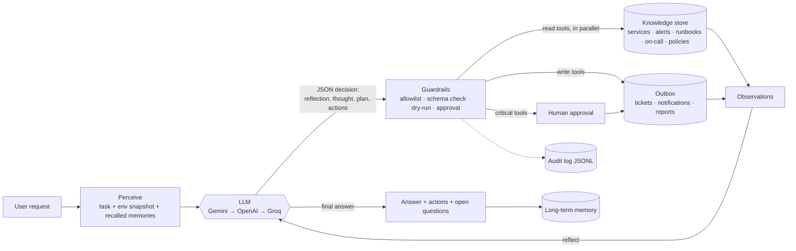

# agentic-ops-agent

An autonomous **knowledge-execution agent** for IT operations, written in Node.js + TypeScript.
(Built for Xiarch Bharat's assessment, *Option 3: Autonomous Knowledge Execution Agent*.)

You give it a request in plain English, for example *"check our services and handle anything customers are feeling"*.
The agent then works on its own:

1. **Perceives**: reads internal knowledge (service snapshot, live alerts, runbooks, on-call roster, policies) and its memory of past runs.
2. **Reasons**: an LLM decides what is wrong, which runbook or policy applies, and what to do. It writes its reasoning before every action.
3. **Acts**: opens tickets, notifies on-call, writes reports, and *proposes* production changes (rollback or restart) that a human must approve.
4. **Reflects**: reads the results (including denials and errors) and adjusts the plan until the request is handled or the step budget runs out.

There are no hardcoded if/else decisions about incidents. The code only provides tools and guardrails; every decision comes from the LLM.
Production actions are simulated: they are written to `.agent/outbox/` so the project is safe to run anywhere.

## Features vs. the brief

| Requirement / bonus | Where |
| --- | --- |
| Internal knowledge sources (JSON, CSV, markdown); several at once | `data/`, `src/knowledge/store.ts` |
| Answers only from internal knowledge | system prompt in `src/agent/prompt.ts` and read-only tools |
| Reasoning before decisions, explains every action | `reflection`/`thought` fields and a required `why` on each action (`src/agent/parse.ts`) |
| Picks and executes actions automatically | `src/agent/agent.ts`, `src/tools/index.ts` |
| Long-term memory | `src/memory/longTerm.ts` (persists to `.agent/memory.json`, recalled at the start of each run) |
| Parallel actions | read-only tool calls in one step run with `Promise.all` |
| Multi-step reasoning and planning | loop with a `plan` list, up to `--max-steps` |
| Human approval for critical actions | `critical` tools pass through `src/approval.ts` |
| Audit log for every action | `src/logger.ts` writes JSONL to `.agent/runs/<run-id>.jsonl` |
| Incomplete or conflicting information | sample data has a stale snapshot that contradicts newer alerts; policy and prompt tell the model to trust the newer source and say so |
| Reliability | Gemini → OpenAI → Groq fallback with per-attempt timeouts, JSON validation with self-correction |

## Architecture



### Tools

| Tool | Risk | What it does |
| --- | --- | --- |
| `search_knowledge` | read | keyword (TF-IDF) search over all sources |
| `get_service_status` | read | one service + its alerts + snapshot time |
| `list_alerts` | read | alerts, newest first |
| `get_oncall` | read | on-call person and channel for a team |
| `recall_memory` | read | past runs |
| `create_ticket` | write | writes to `outbox/tickets.jsonl` |
| `notify_oncall` | write | writes to `outbox/notifications.jsonl` |
| `write_report` | write | markdown report in the outbox |
| `rollback_deploy` | critical | needs approval, writes to `outbox/changes.jsonl` |
| `restart_service` | critical | needs approval, writes to `outbox/changes.jsonl` |

`read` tools always run. `write` tools are simulated with `--dry-run`. `critical` tools also need human approval.

## Setup

Requirements: Node.js 20+ and npm.

```bash
git clone https://github.com/Krrishkumar125/agentic-ops-agent.git
cd agentic-ops-agent
npm install
npm test          # 23 tests, no API keys needed (LLM is mocked)
npm run build
cp .env.example .env   # then add at least one key: GEMINI_API_KEY, OPENAI_API_KEY or GROQ_API_KEY
```

## Run

```bash
# Default task, real LLM, asks you before any rollback or restart
node dist/cli.js

# Your own request
node dist/cli.js "Why is checkout failing and who should know?"

# Safe modes
node dist/cli.js --dry-run "..."                 # simulate every write/critical action
node dist/cli.js --approve deny "..."            # never allow production changes
node dist/cli.js --tools list_alerts,search_knowledge,write_report "..."   # tool allowlist
node dist/cli.js --max-steps 4 "..."

# No API key? Offline replay of the demo task (recorded model replies, for trying the CLI only)
node dist/cli.js --mock

# Demo script: dry run, then a live run with approvals denied
npm run demo
```

During development you can skip the build with `npm run dev -- "<task>"`.

Point `--data` at another folder with the same file layout to use your own knowledge.

## Example run (abridged, `npm run demo`, second part)

```
--- step 1 ---
think:   The snapshot says payments-api is healthy but notifications is down and fraud-check degraded.
         Snapshot is from 09:00; I should check the newer alerts and the runbooks before acting.
act:     list_alerts {"min_severity":"medium"}             (these three run in parallel)
act:     search_knowledge {"query":"runbook deploy error rate rollback restart crash config"}
act:     search_knowledge {"query":"policy approval conflicting snapshot freeze"}

--- step 2 ---
reflect: ALR-101 (09:12) shows payments-api 5xx at 7.8% after v2.14.0, which conflicts with the
         09:00 snapshot saying healthy. Policy says trust the newer timestamp. RB-1 says rollback + ticket ...
act:     get_oncall x3
act:     rollback_deploy {"service":"payments-api","from_version":"v2.14.0"}
         why: ALR-101 5xx 7.8% > 2% right after v2.14.0; RB-1; newer than snapshot per incident policy
act:     restart_service {"service":"fraud-check"}
[approval] denied (deny mode): rollback_deploy(...)
[approval] denied (deny mode): restart_service(...)

--- step 3 ---
reflect: ... for anything denied I will not retry and will rely on tickets and escalation instead.
act:     create_ticket x2, notify_oncall x3

--- step 4 ---
act:     write_report {"title":"Service health 2026-10-15", ...}

=== DONE after 5 step(s) ===
Three services need attention. payments-api is failing 7.8% of requests since v2.14.0 even though the
older snapshot says healthy; I proposed a rollback (RB-1) and opened a high-severity ticket. ...
Actions executed:
- create_ticket(team=payments, severity=high, title=payments-api 5xx spike after v2.14.0)
- create_ticket(team=growth, severity=high, title=notifications down: missing SMTP_HOST after v3.2.1)
- notify_oncall(channel=#payments-oncall) ...
Open questions:
- Was v2.14.0 the only change to payments-api this morning?
Audit log: .agent/runs/<run-id>.jsonl
```

Real-LLM runs follow the same loop, but the wording and the exact steps vary from run to run.

## Project layout

```
src/
  cli.ts                 entry point, flags, console transcript
  agent/agent.ts         perceive → plan → act → reflect loop
  agent/prompt.ts        system prompt and the initial observation
  agent/parse.ts         JSON extraction and zod validation of model replies
  llm/                   Gemini, OpenAI-compatible (OpenAI, Groq), fallback chain, scripted mock
  tools/registry.ts      allowlist, arg validation, dry-run, approval, audit
  tools/index.ts         the ten tools
  knowledge/store.ts     loads data/ and does keyword search
  memory/                short-term (per run) and long-term (across runs)
  approval.ts            human-in-the-loop prompt
  logger.ts              JSONL audit log
data/                    sample internal knowledge
tests/                   vitest, uses a scripted LLM
scripts/demo.sh
```

## Design decisions

- **Plain TypeScript instead of an agent framework.** The loop is ~150 lines, so every step is easy to read, test and explain. LangGraph or the OpenAI Agents SDK would hide the parts this assessment is about.
- **One JSON decision format instead of each provider's native tool-calling API.** Gemini, OpenAI and Groq all support JSON output, so a single zod-validated schema works across the fallback chain, and switching providers mid-run is safe. If a reply is invalid, the error goes back to the model so it can correct itself (3 tries).
- **Risk levels on tools, enforced in code, not in the prompt.** The model can *ask* for a rollback, but the registry decides whether it runs (allowlist → schema → dry-run → approval). Prompt injection in the data can't skip approval.
- **Parallel reads, sequential writes.** Reads have no side effects, so they run together. Writes run in the order the model gave, so approvals and side effects stay predictable.
- **Per-attempt timeouts.** Each provider gets its own `AbortController` timeout, so a hanging provider costs at most `LLM_TIMEOUT_MS` before the next one is tried.
- **Simple retrieval.** TF-IDF over a few dozen documents is enough here. `KnowledgeStore.search` and `LongTermMemory.recall` are the only places to change for pgvector or another vector DB.
- **Simulated side effects.** Tools write to `.agent/outbox/` instead of calling Jira, Slack or Kubernetes. Swapping in real integrations only means changing a tool's `run` function.

## Limitations

- Actions are simulated; there are no real ticketing, chat or deploy integrations.
- Keyword retrieval misses synonyms (for example "outage" vs. "down"); embeddings would fix that.
- The knowledge is a static snapshot loaded at start-up; a production version would poll live sources.
- Long-term memory is a JSON file with word-overlap recall. It's fine for hundreds of runs, not millions.
- Quality depends on the model. Small models sometimes return invalid JSON (handled by retries) or skip the evidence step.
- `--mock` only replays the bundled demo task. It shows the loop and guardrails without keys, but it is not reasoning; use a real key to see the agent decide.
- Approval is a terminal prompt; with no terminal, critical actions are denied.

## Note on how this was built

Built with AI coding assistance, which the brief allows. The commit history shows the order it was put together in.
